## 단말기 내 중요 정보 저장, 소스코드 난독화 적용

### 환경 세팅
- OS: Windows 10/11 데스크톱
- Android Studio (Stable 버전)
- AVD: Pixel 6, API 33, Google APIs 이미지 (x86_64)
- 실습 앱: DIVA (Damn Insecure and Vulnerable App)
- JDK 17 (Temurin)
- jadx 1.5.6
- apktool(apktool.bat, apktool_3.0.3.jar(저장 시 이름 apktool.jar))
- uber-apk-signer-1.3.0.jar

#### 1. Android Studio 설치
1. developer.android.com 공식 사이트에서 Windows용 다운로드
2. 설치 옵션은 기본값, 첫 실행 SDK 마법사는 Standard로 진행함
3. 이때 adb가 들어 있는 Platform-Tools도 같이 설치됨

#### 2. AVD(가상 폰) 만들기
1. Virtual Device Manager > Create Device > Pixel 6
2. 시스템 이미지는 **API 33, Google APIs** 선택
   - 이름에 **Google Play**가 붙은 이미지는 `adb root`가 막혀 있어서 실습에 불편하다고 함...
3. Finish 후 ▶ 버튼으로 실행

#### 3. adb PATH 등록
`adb`가 인식되지 않으면 환경 변수 Path에 아래 경로를 추가하기

```
C:\Users\사용자이름\AppData\Local\Android\Sdk\platform-tools
```

1. 시작 메뉴에서 "시스템 환경 변수 편집" > 환경 변수
2. 사용자 변수 `Path` > 편집 > 새로 만들기 > 경로 붙여넣기
3. **PowerShell을 완전히 껐다 켠 뒤** 확인

```powershell
adb version
```

#### 4. root 쉘 확인
```powershell
adb devices
adb root
adb shell id
```
`uid=0(root)`가 나오면 성공. Google Play 이미지면 `adbd cannot run as root in production builds`가 나옴.
이 root는 가상 폰 안에서만 유효하다.

#### 5. DIVA APK 준비
- 공식 저장소(payatu/diva-android)는 소스코드만 있고 빌드된 APK가 없었음...하도 오래전꺼라
- 소스를 빌드하려면 오래된 Gradle과 최신 JDK 충돌 가능성이 있어서, 빌드된 APK 저장소(https://github.com/0xArab/diva-apk-file)를 이용하여 에뮬레이터에만 설치함
- README의 clone 주소(xAltmime)가 저장소와 달라서, 직접 확인한 저장소(0xArab)에서 ZIP으로 받음
- 작업 폴더는 `C:\Windows\system32`가 아닌 별도 폴더로 생성해서 관리

#### 6. 설치와 검증
```powershell
cd D:\android_lab\diva-apk-file-main
adb devices
adb install DivaApplication.apk
adb shell pm list packages | findstr diva
adb shell dumpsys package jakhar.aseem.diva | findstr permission
```
- 패키지명이 `jakhar.aseem.diva`인지 확인
- 권한이 저장소/인터넷/알림/미디어 정도인지 확인
- 참고로 PowerShell에서는 `grep` 대신 `findstr`을 씀...

#### 7. 앱 샌드박스 확인
```powershell
adb shell pm path jakhar.aseem.diva
adb shell ls /data/data/jakhar.aseem.diva
```
- `pm path`: 앱 설치 위치 (`base.apk`)
- `/data/data/패키지명`: 앱 전용 저장 공간(샌드박스)
- 처음엔 `cache`, `code_cache`, `databases`만 보이고, 앱에서 값을 저장하면 `shared_prefs` 등이 생김

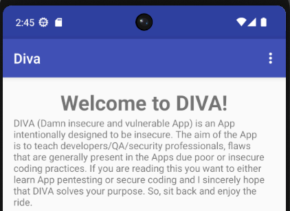
_DIVA 설치 완_

#### 막혔던 점 모음
| 증상 | 원인/해결 |
|---|---|
| `adb`이 인식되지 않음 | Path 미등록. 등록 후 터미널 재시작 |
| `adb root` 실패 | Google Play 이미지 사용 중. Google APIs 이미지로 변경 |
| 공식 DIVA 저장소에 APK 없음 | 소스 저장소라서 그렇다. 빌드된 APK를 별도로 구해서 검증 후 사용 |


#### 가상폰 킨 후 윈도우 파워쉘에서 입력해야 할 명령어
|---|---|
| 연결된 기기 확인 | `adb devices` |
| root로 재시작 (폰 켤 때마다) | `adb root` |
| root 확인 | `adb shell id` |


### DIVA 실습 내용

#### [단말기 내 중요정보 저장] Insecure Data Storage - Part 1

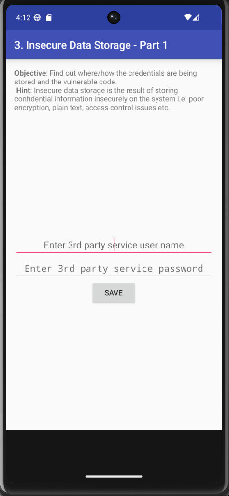
_DIVA Insecure Data Storage - Part 1_

앱을 열어서 3.Insecure Data Storage - Part 1 기능에 접속한 후. 아이디와 패스워드를 저장한다. 이 정보들이 단말기에 저장돼서 생기는 취약점인데, 암호화되어 있지 않은 상태이다.

해당 앱은 SharedPreferences 기능을 사용하여 데이터를 저장하므로, shared_prefs/ 를 확인한다. 평문으로 저장된 패스워드가 노출된다.


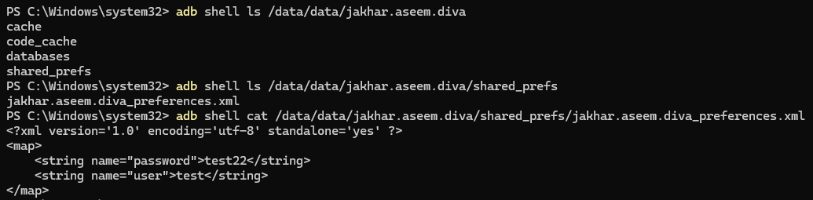
_단말기 내 패스워드 노출_


#### [단말기 내 중요정보 저장] Insecure Data Storage - Part 2

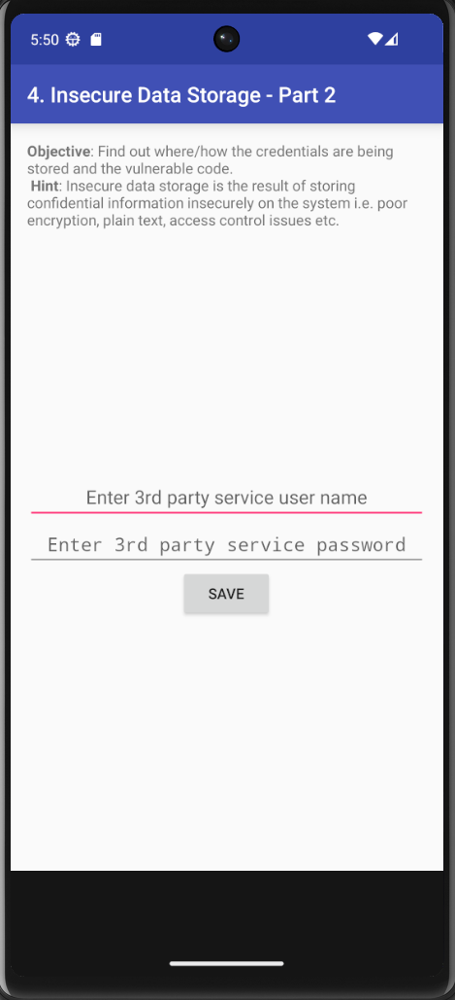
_DIVA Insecure Data Storage - Part 2_

Part 1이랑 똑같은데.. 데이터 저장소만 다름.

SQLite를 이용하여 데이터를 평문으로 저장함...

그래서 db파일 찾아서 보면 된다.

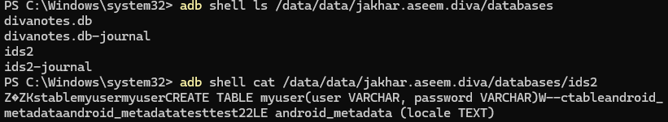
_db 파일 확인_

그냥 cat으로 읽으면 글자가 깨지기 때문에 아래와 같이 sqlite 프롬프트 열어서 확인한다.

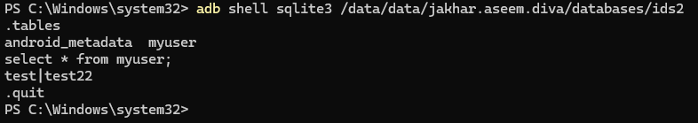
_SQLite로 확인_


#### [단말기 내 중요정보 저장] Insecure Data Storage - Part 3

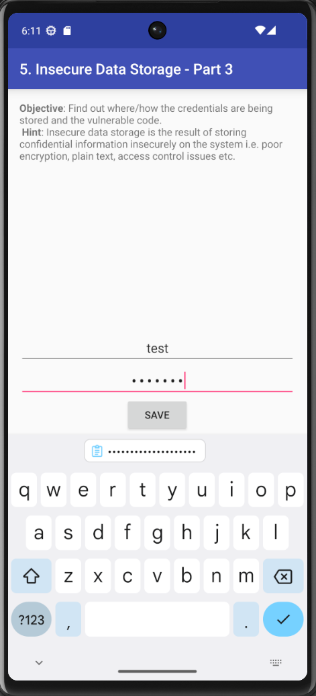
_DIVA Insecure Data Storage - Part 3_

데이터 저장소가 임시 파일로 바뀐 문제이다.

최근에 생성된 파일 목록을 보고 임시 파일의 내용을 읽어오면 된다.

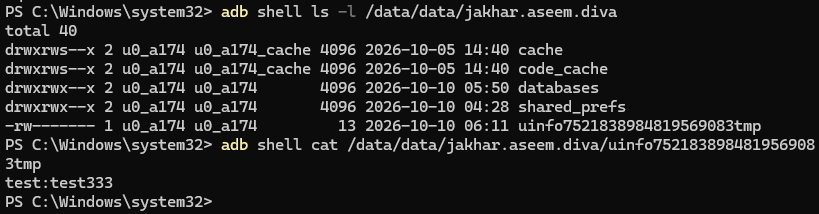
_임시 파일 내용 확인_


#### [단말기 내 중요정보 저장] Insecure Data Storage - Part 4

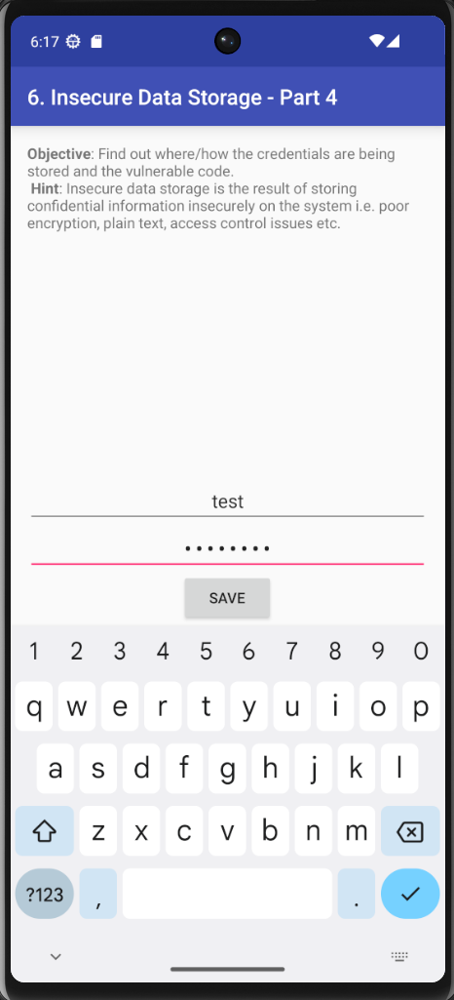
_DIVA Insecure Data Storage - Part 4_

데이터를 외부 저장소에 평문으로 저장하는 경우이다.
근데... 구성한 환경이 DIVA에 딱 맞는 완전 구버전 안드로이드는 아니라서... 권한 문제로 외부 저장소에 저장이 안 돼서 권한부터 주고 시작해야 함.

```
adb shell dumpsys package [패키지명] | findstr permission
```
전체 권한을 확인해보면, 3개의 섹션으로 나뉘어진다.

| 섹션 | 의미 |
|---|---|
| `requested permissions` | 앱이 요청한 권한 전체 (Manifest에 선언된 것) |
| `install permissions` | 설치할 때 자동으로 허용된 권한 (예: INTERNET) |
| `runtime permissions` | 사용자가 허용해야 켜지는 권한. `granted=true/false`로 현재 상태 표시 |

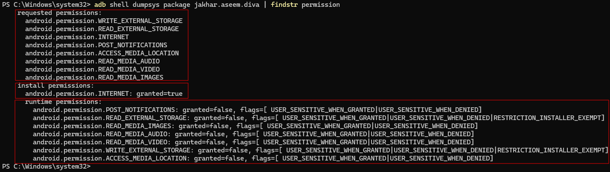
_권한 확인_

WRITE_EXTERNAL_STORAGE: granted=true로 바꿔준다.

```
adb shell pm grant jakhar.aseem.diva android.permission.WRITE_EXTERNAL_STORAGE
```

요즘은 WRITE_EXTERNAL_STORAGE 안 쓴다는데... 암튼 앱이 데이터를 외부 저장소에 저장할 권한이 없어서 pm grant로 직접 준 상태.

그 뒤 아이디/패스워드를 저장하고, 외부 저장소를 뒤진다. 첨엔 adb shell [명령어] 구조로 sdcard 디렉터리 내부 보다가.. storage 하위에 있다길래 find로 찾음. 

```
adb shell "find /storage/emulated/0/ -type f -mmin -30"
```
생성된 파일을 읽으면 된다.

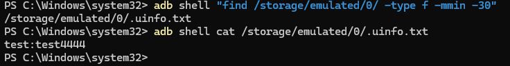
_계정 정보 확인_


위의 랩 4개로 알게 된 것을 정리하면 아래와 같다.

*안드로이드 앱이 데이터를 저장하는 방법*

| 방법 | 어떤 데이터에 쓰나 | 샌드박스 내 위치 |
|---|---|---|
| SharedPreferences | 설정값, 로그인 상태 등 작은 key-value | `shared_prefs/` |
| SQLite / Room | 목록, 대화, 거래내역 등 구조화된 데이터 | `databases/` |
| 내부 파일 | 임의 파일, 캐시, JSON 등 | `files/`, `cache/` |
| 외부 저장소 | 사진, 문서 등 공유가 필요한 파일 | `/sdcard/...`, `/storage/...` 등 |
| files/DataStore | SharedPreferences의 최신 대체재 (Kotlin 앱) | `datastore/` |
| Keystore | 암호키 보관 전용 (데이터 자체가 아니라 키를 보호) | 앱 폴더 밖, 시스템이 관리 |

> 점검 시 샌드박스 폴더 전체를 훑어서 위 위치 어디에든 중요정보가 남아 있는지 확인한다.


#### [프로그램 무결성]

먼저 DIVA를 리패키징한다.

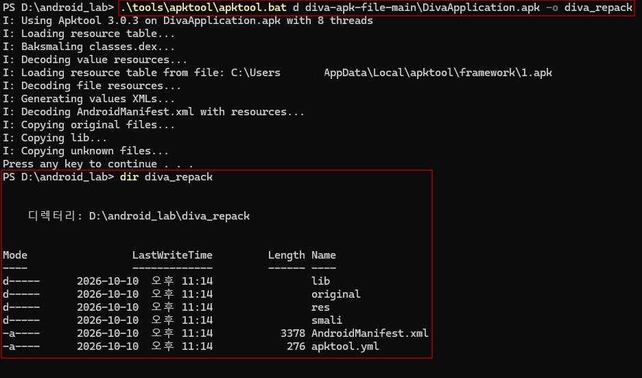
_DIVA 리패키징_

diva_repack\res\values\strings.xml 에서 앱 이름을 DIVA-REPACKED로 변경한 후 저장한다.

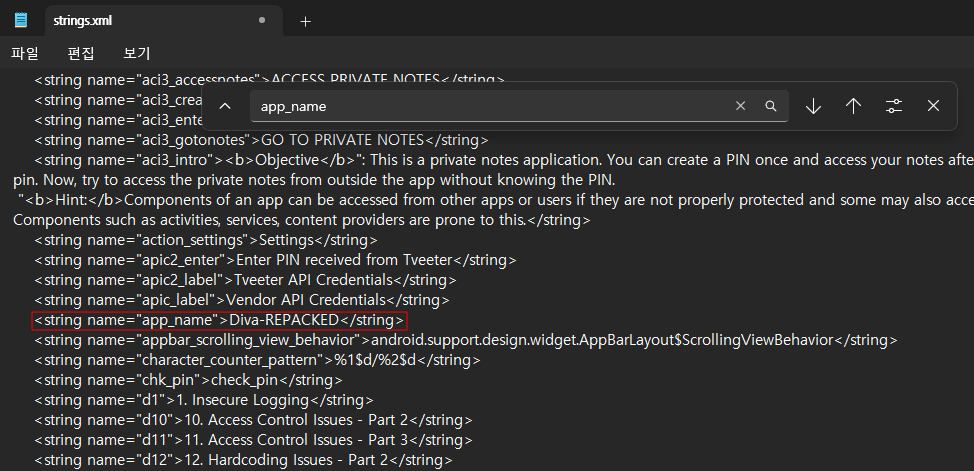
_DIVA 이름 변경_

이후 재빌드를 하고, 서명해야 재설치 가능하다.


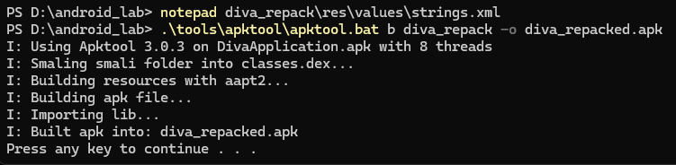
_DIVA-REPACKED 빌드_


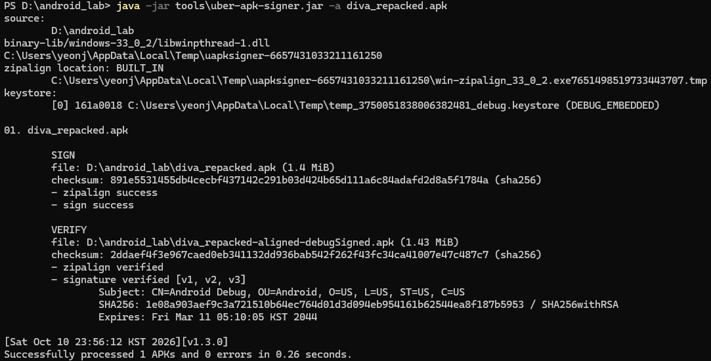
_DIVA-REPACKED 서명_

이후 가상폰을 켜서, 원래 있던 DIVA를 삭제하고 리패키징한 DIVA-REPACKED를 설치한다.

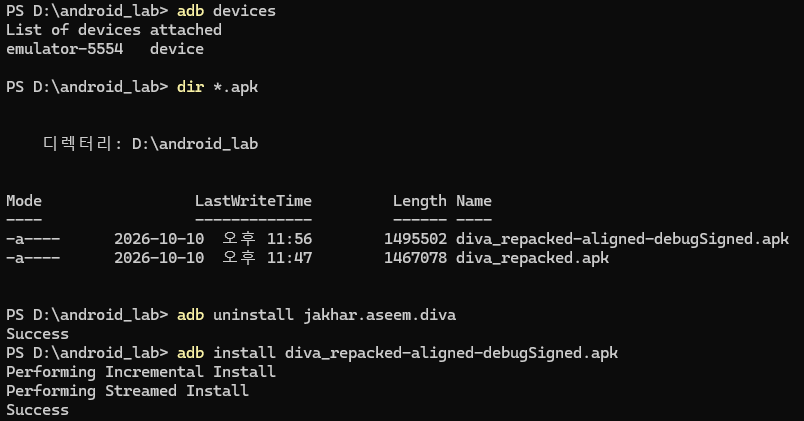
_DIVA-REPACKED 설치_

가상폰에서 설치된 DIVA-REPACKED의 작동까지 되는 것을 확인할 수 있다.

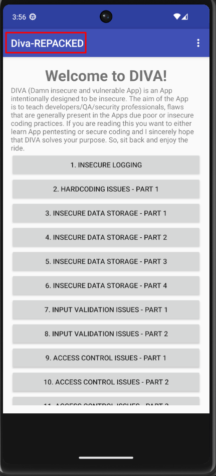
_DIVA-REPACKED 작동 확인_


정리하면,
애플리케이션이 변조되는 것을 못 막아서 생기는 취약점이다. 
안드로이드 서명이 보장하는 것은 '같은 서명끼리만 업데이트 가능'이라서, 기존의 앱을 업데이트할 때 동일한 서명이 있는지만 확인하는 정도이다. 그 서명이 원본인지는 확인하지 않는다. 제대로 막는 앱은 서명이 원본 개발자 서명과 일치하는지 코드 안에서 비교하고, 변조로 체크섬/해시가 바뀌는지 검사한다. 이 검사에 걸리면 앱이 즉시 종료되거나 '위변조된 앱'등의 경고를 띄운다.


진단하는 법은 대상 APK 전부 확보해서

```
adb shell pm path [패키지명]
adb pull [나온 경로] target.apk
```

(최신 앱은 split APK라 여러 개가 나올 수 있음) apktool로 디컴파일 및 리빌드, 재서명 후 설치/실행 해보는 것이다.

우회 기법: 무결성 검사가 있어도, 그 검사 코드 자체를 리패키징으로 무력화하거나 Frida로 우회할 수 있으면 여전히 취약하다. (동적 분석 단계에서 다룰 것...ㅜ)


#### [소스코드 난독화 적용]

DIVA는 난독화 안 되어 있는 앱이라 jadx에서 소스코드를 쉽게 읽을 수 있었고, 보통은 난독화를 하는 것 같다. 일단 내장되어 있는 유튜브 앱 확인해봄...

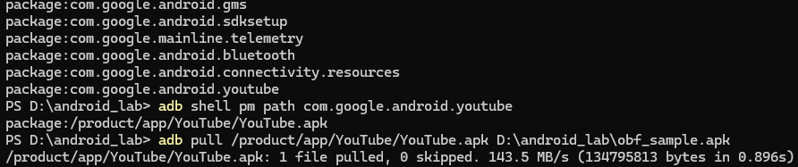
_유튜브 앱 pull_


adb로 pull한 뒤 jadx로 열어보면, 아래와 같이 클래스 명이 a, aa, aaa, ... 등으로 난독화 되어 있는 걸 확인할 수 있다.


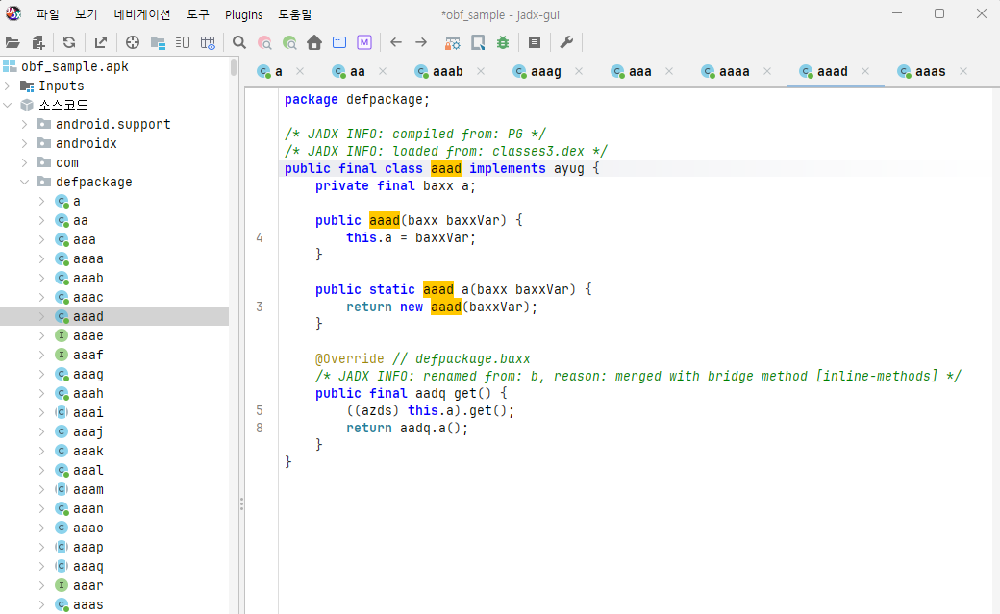
_유튜브 앱 난독화 소스코드 확인_

그러니까 일단 이 취약점은 소스코드가 난독화 되어있는지(클래스, 메서드, 변수명이 a, aa, aaa 등으로 보이는지) 정도만 확인하면 오케이