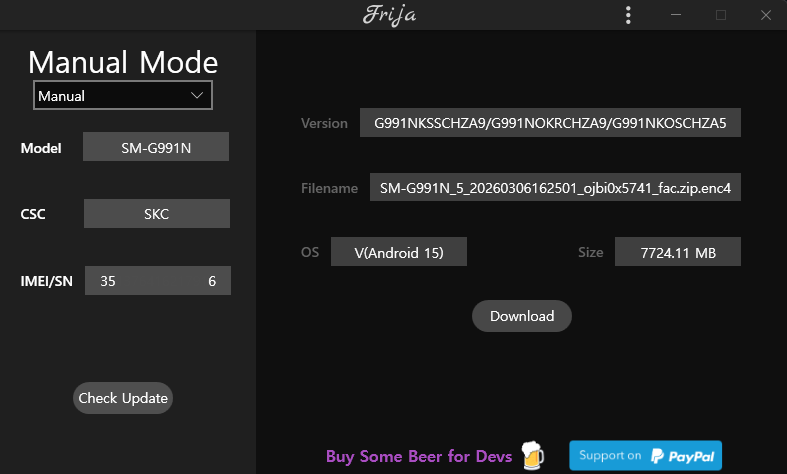
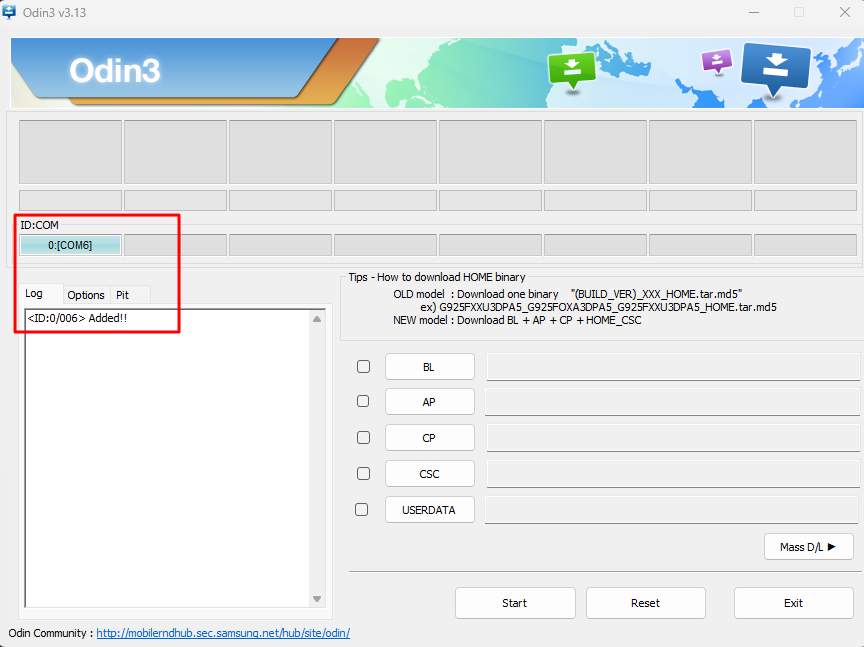
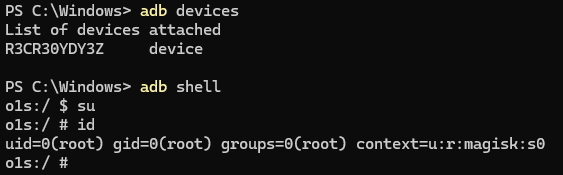
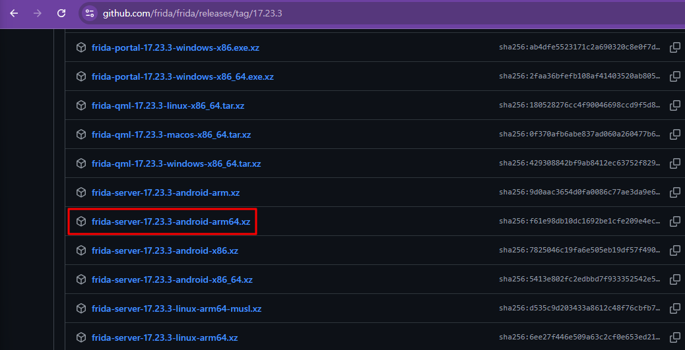

진짜 그냥 환경 세팅 메모한 거... 버전이랑 명령어 등등

1. 루팅 기기 : 갤럭시 s21 (안드로이드 15, One UI 7.0, OEM 잠금해제 토글 활성화, 부트로더 언락)

<div style="height: 70px;"></div>

# 루팅

## 2. ADB 설치 (Windows)

- [https://developer.android.com/studio/releases/platform-tools](https://developer.android.com/studio/releases/platform-tools)
- `platform-tools-latest-windows.zip` 압축 해제 (경로는 짧은 영문으로.. 그래야 나중에 관리 편하다고 함)
- 확인

```powershell
adb --version
```

<div style="height: 70px;"></div>

## 3. 기기 연결 & 정보 확인

```powershell
adb devices                          # device 상태 확인
adb shell getprop ro.csc.sales_code  # CSC 확인 → SKC
```

<div style="height: 70px;"></div>

## 4. 펌웨어 다운로드 (Frija)

- [https://github.com/SlackingVeteran/frija/releases](https://github.com/SlackingVeteran/frija/releases) → 최신 zip → `Frija.exe`
- 최초 실행 시 Microsoft Windows Desktop Runtime 8.0.x 설치하라고 뜸 (정상)
- Manual 모드로 입력
  - Model: `SM-G991N`
  - CSC: `SKC`
  - IMEI/SN: 다이얼러에서 `*#06#` 또는 설정 → 휴대전화 정보
- Check Update → Download → 저장 (예: `D:\firmware`)


_Frija로 펌웨어 다운로드_

- 결과물 : `BL_`, `AP_`, `CP_`, `CSC_`(+`HOME_CSC_`) → `.tar.md5` 4~5개
- 루팅엔 **AP_ 파일만** 사용, 나머지는 복구용으로 컴터에 보관했음.
- 참고로 만약 펌웨어 버전이 다르면 AP말고도 BL, CP, CSC 같이 사용한다고 함...뭔말인지 몰루 

<div style="height: 70px;"></div>

## 5. Magisk 앱 설치 (폰)

- [https://github.com/topjohnwu/Magisk/releases](https://github.com/topjohnwu/Magisk/releases)
- **"Latest" 라벨 붙은 stable만** 사용 (현재 v30.7). "Pre-release"(canary)는 거를 것
- `Magisk-v30.7.apk` (약 11MB) 다운로드
- adb로 설치하는 게 편함 (Play Protect가 막으면 먼저 OFF)

```powershell
adb install "경로\Magisk-v30.7.apk"
```

- 앱 최초 실행 시 "추가 설정 위해 재시작" 뜨면 → 재부팅
- 확인 : 패키지 `com.topjohnwu.magisk`, 설치됨 30.7(30700), 채널 안정

<div style="height: 70px;"></div>

## 6. AP 파일을 폰으로 전송

```powershell
adb push "D:\firmware\AP_G991N....tar.md5" /sdcard/Download/
```

폰 저장공간 여유 있어야 하고, 용량이 커서 시간 좀 걸림

<div style="height: 70px;"></div>

## 7. Magisk로 AP 패치 (폰)

- Magisk 앱 → Install → Select and Patch a File
- 다운로드 폴더 → `AP_...tar.md5` 선택 (AP 통째로)
- "raw 이미지(.img) 또는 ODIN tar(.tar) 선택" 안내가 떠도 무시하고 선택하면 됨 (`.tar.md5`도 ODIN tar로 정상 인식함)
- 패치 완료 → `/sdcard/Download/magisk_patched_xxxxx.tar` 생성

<div style="height: 70px;"></div>

## 8. 패치 결과물 PC로 회수

```powershell
adb shell ls /sdcard/Download/
adb pull /sdcard/Download/magisk_patched_xxxxx.tar "D:\firmware\"
```

<div style="height: 70px;"></div>

## 9. Odin 플래시

- Odin 3.13.1 실행 (odindownload.com 등 신뢰할 만한 곳에서 받고, virustotal 한 번 돌려보는 거 권장)
- Download 모드 진입

```powershell
adb reboot download
```

경고 화면 → 볼륨 업 → "Downloading..."

- ID:COM 파란색으로 뜨는지 확인 (안 뜨면 삼성 USB 드라이버 설치 / 케이블·포트 교체)


_ID:COM 인식 확인_

- AP 체크 → 패치된 파일 지정
- BL · CP · CSC · USERDATA는 **비워둘 것** (건드리지 말기)
- Options 탭 : Auto Reboot ✓, F. Reset Time ✓, Re-Partition ✗
- Start → 초록색 PASS! 뜨면 성공

<div style="height: 70px;"></div>

## 10. 첫 부팅 처리

- 부팅 시 "삼성 공식 소프트웨어 아님" 경고 화면 = 루팅 정상 신호 (앞으로 매 부팅마다 뜸)
- `Can't load Android system` (data 파티션 불일치) 뜨면
  - Recovery에서 Factory data reset 선택 → 재부팅
- 첫 부팅은 5~15분 걸릴 수 있음 (정상이니까 쫄지 말기)

<div style="height: 70px;"></div>

## 11. 루트 최종 확인

```powershell
adb shell
su          # → 폰에 Magisk 루트 허용 팝업 뜨면 [허용]
id
```


_uid=0(root) ... context=u:r:magisk:s0 → 루팅 완료_

<div style="height: 70px;"></div>

## 복구 (문제 생겼을 때)

- Download 모드 → Odin에 원본 BL+AP+CP+CSC 4개 전부 지정 → Start
- 완전 초기화 복구는 `CSC` 사용 (`HOME_CSC` 아님)
- 원본 펌웨어는 OEM 잠금이랑 상관없이 플래시되니까 언제든 복구 가능

## 참고

- Knox 영구 트립됨 (삼성페이 등 일부 하드웨어 보안기능 날아감) → 서브폰이라 상관없음
- OTA 업데이트 받으면 루팅 풀림 → 자동 업데이트 OFF 권장
- 재루팅은 Magisk 앱 안에서 Direct Install로 간단하게 가능 (통째로 다시 플래시할 필요 X)

<div style="height: 70px;"></div>

# Frida 세팅

## 1. PC 쪽 - Frida 설치

```powershell
pip install frida-tools frida
```

- 설치 버전 : frida 17.23.3 / frida-tools 14.11.0
- 근데 설치하고 `frida --version`이 인식이 안 됨 → Python Scripts 폴더가 PATH에 없어서 그런 거였음
- 환경변수 Path에 아래 경로 추가하고 PowerShell 재시작하면 해결

```
C:\Users\yeonj\AppData\Local\Packages\PythonSoftwareFoundation.Python.3.13_qbz5n2kfra8p0\LocalCache\local-packages\Python313\Scripts
```

<div style="height: 70px;"></div>

## 2. 폰 쪽 - frida-server 준비

- **PC frida 버전(17.23.3)이랑 똑같은 버전**의 frida-server 받아야 함
- [https://github.com/frida/frida/releases/tag/17.23.3](https://github.com/frida/frida/releases/tag/17.23.3) → `frida-server-17.23.3-android-arm64.xz`


_S21은 arm64_

- 압축 풀고 폰으로 push

```powershell
adb push "경로\frida-server-17.23.3-android-arm64" /data/local/tmp/frida-server
adb shell "chmod 755 /data/local/tmp/frida-server"
```

처음 push할 때 `/data/local/tmp/frida-server`가 디렉토리로 잘못 만들어지는 삽질이 있었음.. 그럴 땐 지우고 다시 push

```powershell
adb shell "rm -rf /data/local/tmp/frida-server"
```

<div style="height: 70px;"></div>

## 3. frida-server 실행

```powershell
adb shell "su -c '/data/local/tmp/frida-server &'"
```

- 실행하면 Magisk superuser 허용 팝업 뜸 → 허용
- `Address already in use` 에러는 이미 떠 있다는 뜻이라 정상

<div style="height: 70px;"></div>

## 4. PC↔폰 포트 연결 및 검증

```powershell
adb forward tcp:27042 tcp:27042
frida-ps -U
adb shell "ps -A | grep frida"
```

폰 프로세스 목록 쭉 뜨고 frida에 root 권한 붙어있으면 연동 완료

<div style="height: 70px;"></div>


## 5. Zygisk + DenyList 설정

Magisk 앱 → 설정 → Zygisk ON → 재부팅
Magisk 앱 → Configure DenyList → 설정할 앱 전부 체크

목적: 앱이 su/Magisk 흔적을 시스템 레벨에서 못 보게 숨겨서 루팅 탐지를 1차로 우회하기 위함.

<div style="height: 70px;"></div>


## 6. jadx-gui

jadx-gui-1.5.6 버전으로 설치함


<div style="height: 70px;"></div>


## 참고. 케이블 뺐다 꽂으면?

매번 다시 frida 서버 띄워야 함. frida-server는 데몬처럼 등록되는 게 아니라 그때그때 수동으로 띄운 프로세스라서, 폰 재부팅하거나 프로세스 죽으면 사라짐. 그러니까 USB 뺐다 꽂은 것 자체보다는 "폰 재부팅했는지", "frida-server가 살아있는지"가 기준

| 상황 | 다시 해야 하는 작업 |
| --- | --- |
| USB만 뺐다 꽂음 (재부팅 X, frida-server 살아있음) | `adb forward tcp:27042 tcp:27042`만 다시 |
| 폰 재부팅함 | frida-server 재실행 + forward 다시 |
| frida-server 죽음/크래시 | 재실행 + forward 다시 |

매번 확인하는 순서

```powershell
adb shell "ps -A | grep frida"      # 안 뜨면 꺼진 것 → 재실행
adb forward tcp:27042 tcp:27042
frida-ps -U                          # 목록 뜨면 OK
adb shell "su -c '/data/local/tmp/frida-server &'" # 쉘에 루트 권한 부여
```

<div style="height: 70px;"></div>


## 참고. 기기 재부팅 후 기기 연결이 unauthorized로 표시될 때

USB 디버깅 토글은 켜져있어도, PC별 RSA 키 승인이 별도로 필요한 상태라서 그럼...

해결법:
adb kill-server → adb start-server → 폰 화면 잠금해제 상태에서 재시도 → 승인 팝업 뜸 → 허용


## 참고. Frida 사용법

탐지 기능을 대상으로 하는 사용자 지정 스크립트를 작성하여 .js파일로 저장한 뒤, 해당 파일 위치에서 아래 명령어 실행:
```
frida -l <script.js> <apk_package_name> -U
```
-l : 스크립트 로드
-U : 연결된 장치에서 애플리케이션을 실행


또는 
```
frida -U -f <apk_package_name> -l <script.js> --pause
```

입력한 후 

```
%resume
```
를 입력해서 --pause로 멈춰둔 앱의 메인 스레드를 한 번 재개할 수 있음. 스크립트를 앱 코드보다 먼저 넣어두려고 쓰는 방식이라고 함...


# 추가 세팅
JDK 25 설치하고 Ghidra 12.2 다운받음... .so 파일 읽으려면 Ghidra 필요한데 JDK 25 버전 필요햇음