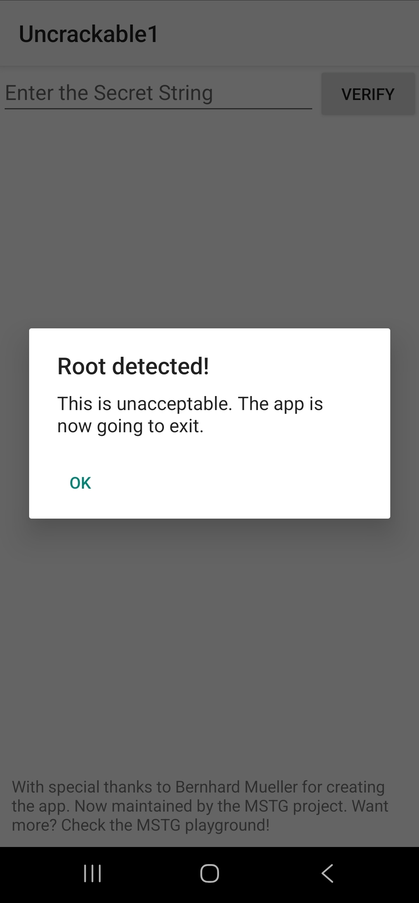
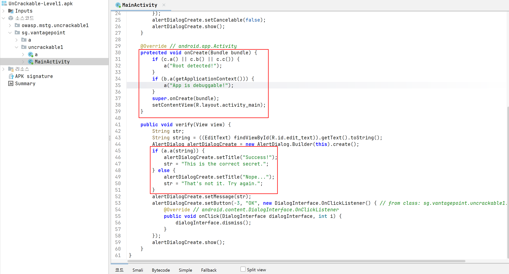
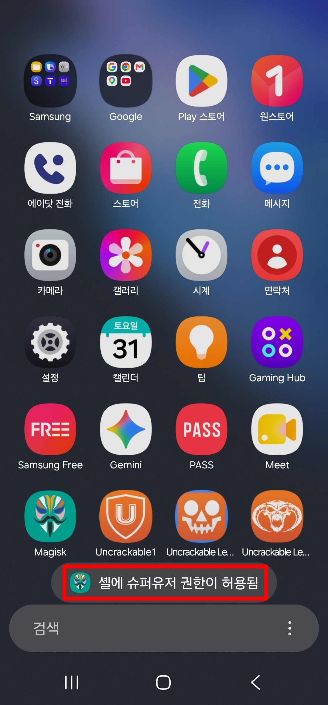
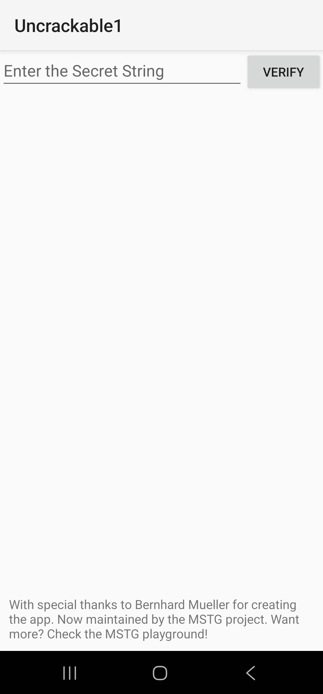
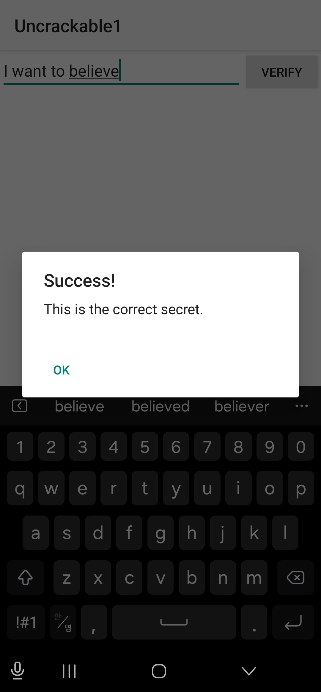

루팅해둔 폰으로 앱에 접근 시도하면 "Root detected!" 출력과 함께 접근이 막히는 상태이고, 이걸 우회하여 패스워드 인증까지 성공해야 한다.



_uncrackable1_


## 소스 코드 해석 및 풀이

루팅 탐지 및 디버깅 탐지, 패스워드 인증 함수를 호출하는 부분은 MainActivity 파일에 있다. (실제 로직은 sg.vantagepoint.a.c, sg.vantagepoint.a.b, sg.vantagepoint.uncrackable1.a 클래스에 있었음)


_MainActivity_


```java
package sg.vantagepoint.uncrackable1;

import android.app.Activity;
import android.app.AlertDialog;
import android.content.DialogInterface;
import android.os.Bundle;
import android.view.View;
import android.widget.EditText;
import owasp.mstg.uncrackable1.R;
import sg.vantagepoint.a.b;
import sg.vantagepoint.a.c;

/* JADX INFO: loaded from: classes.dex */
public class MainActivity extends Activity {
    private void a(String str) {
        AlertDialog alertDialogCreate = new AlertDialog.Builder(this).create();
        alertDialogCreate.setTitle(str);
        alertDialogCreate.setMessage("This is unacceptable. The app is now going to exit.");
        alertDialogCreate.setButton(-3, "OK", new DialogInterface.OnClickListener() { // from class: sg.vantagepoint.uncrackable1.MainActivity.1
            @Override // android.content.DialogInterface.OnClickListener
            public void onClick(DialogInterface dialogInterface, int i) {
                System.exit(0);
            }
        });
        alertDialogCreate.setCancelable(false);
        alertDialogCreate.show();
    }

    @Override // android.app.Activity
    protected void onCreate(Bundle bundle) {
        if (c.a() || c.b() || c.c()) {
            a("Root detected!");
        }
        if (b.a(getApplicationContext())) {
            a("App is debuggable!");
        }
        super.onCreate(bundle);
        setContentView(R.layout.activity_main);
    }

    public void verify(View view) {
        String str;
        String string = ((EditText) findViewById(R.id.edit_text)).getText().toString();
        AlertDialog alertDialogCreate = new AlertDialog.Builder(this).create();
        if (a.a(string)) {
            alertDialogCreate.setTitle("Success!");
            str = "This is the correct secret.";
        } else {
            alertDialogCreate.setTitle("Nope...");
            str = "That's not it. Try again.";
        }
        alertDialogCreate.setMessage(str);
        alertDialogCreate.setButton(-3, "OK", new DialogInterface.OnClickListener() { // from class: sg.vantagepoint.uncrackable1.MainActivity.2
            @Override // android.content.DialogInterface.OnClickListener
            public void onClick(DialogInterface dialogInterface, int i) {
                dialogInterface.dismiss();
            }
        });
        alertDialogCreate.show();
    }
}
```


여기서 아래의 코드를 보면,

```java
import sg.vantagepoint.a.b;  // debuggable 빌드 체크
import sg.vantagepoint.a.c;  // 루팅 체크

if (c.a() || c.b() || c.c()) {        // 루팅 3종 체크
    a("Root detected!");
}
if (b.a(getApplicationContext())) {   // debuggable 빌드 체크
    a("App is debuggable!");
}
```

저 c.a(), c.b(), c.c() 에 들어가는 조건이 뭔지 몰라도 저 세 조건 중 하나만이라도 만족하면 루팅이 감지되어 "Root detected!"를 출력한다.
마찬가지로 b.a(getApplicationContext())를 만족하면 debuggable 빌드를 확인하고 "App is debuggable!"를 출력한다.

따라서 각 조건의 값을 false 로 리턴하도록 만들면 된다.

```javascript
Java.perform(function () {
    console.log("[*] 스크립트 로드됨");

    // 루팅 탐지 우회 — sg.vantagepoint.a.c
    var RootCheck = Java.use("sg.vantagepoint.a.c");
    RootCheck.a.implementation = function () {
        console.log("[*] c.a() 우회 → false");
        return false;
    };
    RootCheck.b.implementation = function () {
        console.log("[*] c.b() 우회 → false");
        return false;
    };
    RootCheck.c.implementation = function () {
        console.log("[*] c.c() 우회 → false");
        return false;
    };

    // debuggable 빌드 체크 — sg.vantagepoint.a.b
    var DebugCheck = Java.use("sg.vantagepoint.a.b");
    DebugCheck.a.implementation = function (ctx) {
        console.log("[*] b.a() 우회 → false");
        return false;
    };
}); 
```


참고로 c.a(), c.b(), c.c() 선언한 클래스 내용을 보면,

```java
package sg.vantagepoint.a;

import android.os.Build;
import java.io.File;

/* JADX INFO: loaded from: classes.dex */
public class c {
    public static boolean a() {
        for (String str : System.getenv("PATH").split(":")) {
            if (new File(str, "su").exists()) {
                return true;
            }
        }
        return false;
    }

    public static boolean b() {
        String str = Build.TAGS;
        return str != null && str.contains("test-keys");
    }

    public static boolean c() {
        for (String str : new String[]{"/system/app/Superuser.apk", "/system/xbin/daemonsu", "/system/etc/init.d/99SuperSUDaemon", "/system/bin/.ext/.su", "/system/etc/.has_su_daemon", "/system/etc/.installed_su_daemon", "/dev/com.koushikdutta.superuser.daemon/"}) {
            if (new File(str).exists()) {
                return true;
            }
        }
        return false;
    }
}
```

- c.a()에서 PATH에 'su' 파일이 있는지 확인하고
- c.b()에서 OS 빌드 서명키가 test-keys인지 확인하고
- c.c()에서 고정된 su 관련 경로 목록에 파일이 있는지 확인한다.


c.b()에서 OS 빌드 서명키가 test-keys인지 확인하는 게 루팅 탐지 로직에 들어가는 이유:

Build.TAGS는 OS 이미지를 어떤 빌드 설정으로 컴파일했는지 나타내는 값이다. 제조사가 일반 소비자용으로 출고하는 공식 빌드는 release-keys로 서명되지만, 커스텀 ROM, 에뮬레이터, eng/userdebug 빌드는 보통 AOSP 기본값인 test-keys로 서명된다.

이런 환경(커스텀 ROM을 직접 설치하거나 에뮬레이터/eng 빌드를 쓰는 사용자)은 애초에 OS를 직접 다루는 경우가 많아 루팅도 함께 돼 있을 가능성이 높기 때문에, test-keys 여부를 "루팅 가능성이 높은 환경인지"로 판단하는 기준 중 하나로 쓴다.

다만 이건 통계적인 거라서... 항상 루팅 여부를 test-keys로 알 수 있는 건 아니다. Magisk 같은 일반적인 루팅 방식은 boot.img만 패치하기 때문에 Build.TAGS 자체를 바꾸지 않는다. 그래서 삼성/구글 공식 롬을 Magisk로 루팅해도 release-keys가 그대로 유지되는 경우가 많고, 특히나 요즘은 test-keys 체크만으로는 Magisk 루팅을 거의 못 잡아낸다고 함...


또한 패스워드 인증 로직을 보면,

```java
if (a.a(string)) {
    alertDialogCreate.setTitle("Success!");
    str = "This is the correct secret.";
} else {
    alertDialogCreate.setTitle("Nope...");
    str = "That's not it. Try again.";
}
```

사용자가 입력한 값 string을 a.a()에 넘겨서 인증 성공 여부를 판단하고 있다. a.a() 안에서는 하드코딩된 암호문을 AES로 복호화한 값과 입력값을 equals로 비교한다.

참고로 이름이 a인 클래스가 두 개라 헷갈리기 쉬운데, 여기서 호출하는 a는 MainActivity와 같은 패키지에 있는 sg.vantagepoint.uncrackable1.a (비교 로직)이고, 그 안에서 다시 호출하는 sg.vantagepoint.a.a가 AES 복호화를 담당한다.

sg.vantagepoint.uncrackable1.a 클래스는,

```java
package sg.vantagepoint.uncrackable1;

import android.util.Base64;
import android.util.Log;

/* JADX INFO: loaded from: classes.dex */
public class a {
    public static boolean a(String str) {
        byte[] bArrA;
        byte[] bArr = new byte[0];
        try {
            bArrA = sg.vantagepoint.a.a.a(b("8d127684cbc37c17616d806cf50473cc"), Base64.decode("5UJiFctbmgbDoLXmpL12mkno8HT4Lv8dlat8FxR2GOc=", 0));
        } catch (Exception e) {
            Log.d("CodeCheck", "AES error:" + e.getMessage());
            bArrA = bArr;
        }
        return str.equals(new String(bArrA));
    }

    public static byte[] b(String str) {
        int length = str.length();
        byte[] bArr = new byte[length / 2];
        for (int i = 0; i < length; i += 2) {
            bArr[i / 2] = (byte) ((Character.digit(str.charAt(i), 16) << 4) + Character.digit(str.charAt(i + 1), 16));
        }
        return bArr;
    }
}
```

sg.vantagepoint.a.a.a(key, encData)가 실제 AES 복호화를 수행하는 부분이다. sg.vantagepoint.a.a 클래스의 내용은 아래와 같다.

```java
package sg.vantagepoint.a;

import java.security.InvalidKeyException;
import java.security.NoSuchAlgorithmException;
import javax.crypto.Cipher;
import javax.crypto.NoSuchPaddingException;
import javax.crypto.spec.SecretKeySpec;

/* JADX INFO: loaded from: classes.dex */
public class a {
    public static byte[] a(byte[] bArr, byte[] bArr2) throws NoSuchPaddingException, NoSuchAlgorithmException, InvalidKeyException {
        SecretKeySpec secretKeySpec = new SecretKeySpec(bArr, "AES/ECB/PKCS7Padding");
        Cipher cipher = Cipher.getInstance("AES");
        cipher.init(2, secretKeySpec);
        return cipher.doFinal(bArr2);
    }
}
```

SecretKeySpec에 넘긴 "AES/ECB/PKCS7Padding"은 알고리즘 이름으로만 쓰이고, 실제 암호화 모드는 Cipher.getInstance("AES")의 기본값인 AES/ECB/PKCS5Padding이다. (cipher.init의 2는 Cipher.DECRYPT_MODE)

루팅 탐지 우회부터 복호화 비밀번호를 얻는 것 까지의 스크립트는 아래와 같음.

```javascript
// uncrackable1.js

Java.perform(function () {
    console.log("[*] 스크립트 로드됨");

    // 루팅 탐지 우회
    var RootCheck = Java.use("sg.vantagepoint.a.c");
    RootCheck.a.implementation = function () { return false; };
    RootCheck.b.implementation = function () { return false; };
    RootCheck.c.implementation = function () { return false; };

    // debuggable 빌드 체크
    var DebugCheck = Java.use("sg.vantagepoint.a.b");
    DebugCheck.a.implementation = function (ctx) { return false; };

    // 비밀번호 복호화 가로채기
    var SecretClass = Java.use("sg.vantagepoint.a.a");
    SecretClass.a.overload('[B', '[B').implementation = function (key, enc) {
        var result = this.a(key, enc);
        var secret = Java.use("java.lang.String").$new(result);
        console.log("[*] 복호화된 비밀번호: " + secret);
        return result;
    };
});
```

저장한 파일 위치에서 frida를 이용한다.

```bash
frida -U -f owasp.mstg.uncrackable1 -l "저장한 스크립트 절대경로" --pause
```


나는 클로드가 써준 거 이해만 했는데... OWASP에서는 아래와 같은 스크립트 예시가 있었다.

```javascript
setImmediate(function() { //prevent timeout
    console.log("[*] Starting script");

    Java.perform(function() {
        var mainActivity = Java.use("sg.vantagepoint.uncrackable1.MainActivity");
        mainActivity.a.implementation = function(v) {
           console.log("[*] MainActivity.a called");
        };
        console.log("[*] MainActivity.a modified");

        var aaClass = Java.use("sg.vantagepoint.a.a");
        aaClass.a.implementation = function(arg1, arg2) {
        var retval = this.a(arg1, arg2);
        var password = '';
        for(var i = 0; i < retval.length; i++) {
            password += String.fromCharCode(retval[i]);
        }

        console.log("[*] Decrypted: " + password);
            return retval;
        };
        console.log("[*] sg.vantagepoint.a.a.a modified");
    });
});
```

클로드는 루팅됐는지 판단하는 함수 c.a() || c.b() || c.c() 를 각각 false를 반환하게 만들었는데, OWASP는 경고창을 띄우는 함수 MainActivity.a(String)를 빈 함수로 바꿔서 경고창이 뜨지 않도록 만든다.

복호화 가로채는 부분도 다른데, 클로드는 자바 쪽 String 생성자를 이용해서 복호화된 패스워드를 얻어내고, OWASP는 String.fromCharCode()로 복호화된 바이트 하나하나 문자변환을 한다.


나는 클로드랑 owasp 두 스크립트를 섞어서 아래와 같은 스크립트로 frida 돌렸다.

클로드 버전이 간결하긴 하지만 overload('[B', '[B') 이 부분이 맘에 안 들어서...

```javascript
Java.perform(function() {
    console.log("start");

    var rootingcheck = Java.use("sg.vantagepoint.a.c");
    rootingcheck.a.implementation = function() { return false; };
    rootingcheck.b.implementation = function() { return false; };
    rootingcheck.c.implementation = function() { return false; };

    var debugingcheck = Java.use("sg.vantagepoint.a.b");
    debugingcheck.a.implementation = function() { return false; };

    var password = Java.use("sg.vantagepoint.a.a");
    password.a.implementation = function(arg1, arg2) {
        var retval = this.a(arg1, arg2);
        var secret = '';
        for (var i=0; i < retval.length; i++) {
            secret += String.fromCharCode(retval[i]);
        }
        console.log("Decrypted password: " + secret);
        return retval;
    }
})
```

### 막힌 부분

그런데?? 첨에 frida 돌릴 때 아래와 같이 뜨고 안 돌아감. 분명 폰에 frida 서버는 떠있는딩

```text
     ____
    / _  |   Frida 17.23.3 - A world-class dynamic instrumentation toolkit
   | (_| |
    > _  |   Commands:
   /_/ |_|       help      -> Displays the help system
   . . . .       object?   -> Display information about 'object'
   . . . .       exit/quit -> Exit
   . . . .
   . . . .   Prefer a GUI? Luma is the official Frida app, with a live REPL,
   . . . .   persistent sessions & collaboration. https://luma.frida.re/
   . . . .
   . . . .   Connected to SM G991N (id=~~)
Failed to spawn: need Gadget to attach on jailed Android; its default location is: ~~\frida\gadget-android-arm64.so
```


아니었다. frida-ps -U 명령어만 입력해서 프로세스 목록 다 뜨면 frida 서버 띄워진 줄 알았는데.. 서버가 안 떠 있었던 거임.

그래서 아래와 같은 명령어로 쉘에 루트 권한줘서 frida 서버를 띄운다.

```bash
adb shell "su -c '/data/local/tmp/frida-server &'"
```

그러면 화면 이렇게 뜸


_루트권한 알림창_


이후 아래의 명령어로 root로 잘 돌고 있는지 확인할 수 있다.

참고로 처음에 `adb shell ps -A | grep frida-server` 이라 썼었는데 grep이 안되더라.. 파이프 뒷단의 명령어는 윈도우의 cmd에서 실행되어 그렇다고 한다. 싱기방기... grep 까지 모바일 쉘로 실행시키려면 `adb shell "ps -A | grep frida-server"` 로 입력하면 됨.

```bash
adb shell ps -A | findstr frida-server
```

다시 프리다 실행.(-f 에는 앱 패키지명 그대로 넣기!ㅎ...)

```bash
frida -U -f owasp.mstg.uncrackable1 -l "스크립트 절대경로" --pause
```

%resume 을 입력하여 스크립트를 실행시킨다.

루팅 탐지를 우회하여 앱에 접근되고,


_루팅 탐지 우회_

앱에서 'verify'를 클릭하면 틀린 패스워드라고 출력되지만 쉘에서 스크립트가 동작하여 복호화된 패스워드를 알 수 있다.


```text
Spawned `owasp.mstg.uncrackable1`. Use %resume to let the main thread start executing!
[SM G991N::owasp.mstg.uncrackable1 ]-> %resume
[SM G991N::owasp.mstg.uncrackable1 ]-> start
[SM G991N::owasp.mstg.uncrackable1 ]-> Decrypted password: I want to believe
```

복호화 패스워드 입력하면 끝


_패스워드 입력_