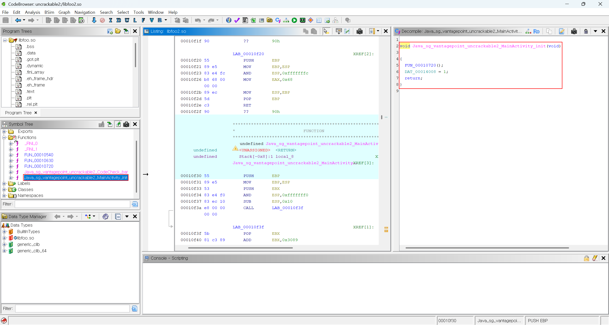
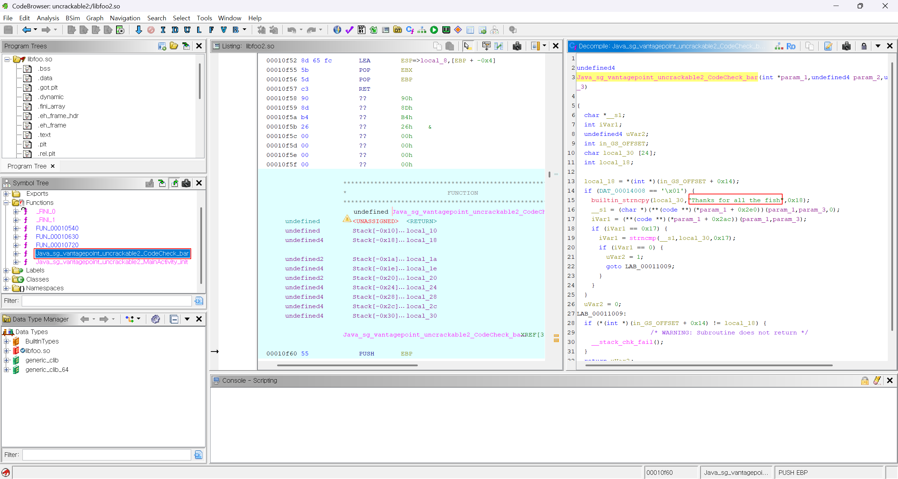
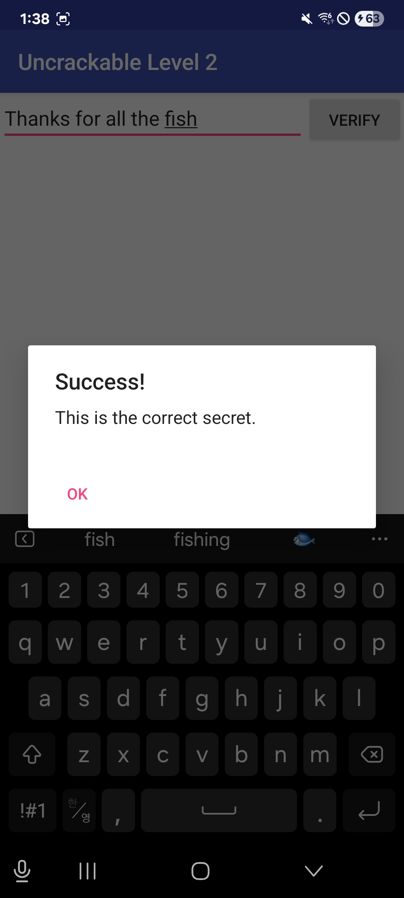

## 풀이

루팅 탐지 및 디버깅 탐지 코드는 아래와 같다.

```java
    private native void init();

    /* JADX WARN: Type inference failed for: r0v4, types: [sg.vantagepoint.uncrackable2.MainActivity$2] */
    @Override // android.support.v7.app.c, android.support.v4.app.h, android.support.v4.app.z, android.app.Activity
    protected void onCreate(Bundle bundle) {
        init();
        if (b.a() || b.b() || b.c()) {
            a("Root detected!");
        }
        if (a.a(getApplicationContext())) {
            a("App is debuggable!");
        }
        new AsyncTask<Void, String, String>() { // from class: sg.vantagepoint.uncrackable2.MainActivity.2
            /* JADX INFO: Access modifiers changed from: protected */
            @Override // android.os.AsyncTask
            /* JADX INFO: renamed from: a, reason: merged with bridge method [inline-methods] */
            public String doInBackground(Void... voidArr) {
                while (!Debug.isDebuggerConnected()) {
                    SystemClock.sleep(100L);
                }
                return null;
            }

            /* JADX INFO: Access modifiers changed from: protected */
            @Override // android.os.AsyncTask
            /* JADX INFO: renamed from: a, reason: merged with bridge method [inline-methods] */
            public void onPostExecute(String str) {
                MainActivity.this.a("Debugger detected!");
            }
        }.execute(null, null, null);
        this.m = new CodeCheck();
        super.onCreate(bundle);
        setContentView(2131296283);
    }
```

그래서 uncrackable1 스크립트랑 비슷하게 아래와 같이 썼는데,
```javascript
Java.perform(function() {
    console.log("start");

    var rootCheck = Java.use("sg.vantagepoint.a.b");
    rootCheck.a.implementation = function() { return false; };
    rootCheck.b.implementation = function() { return false; };
    rootCheck.c.implementation = function() { return false; };

    var debugCheck = Java.use("sg.vantagepoint.a.a");
    debugCheck.a.implementation = function() { return false; };

    console.log("hooks installed");
});
```

?? 루팅 우회는 됐는데 바로 앱에서 튕김

내가 코드를 귀찮아서.. uncrackable1이랑 비슷하겠거니... 대충 봐서 그럼ㅜ

저 루팅 탐지 검사보다 먼저, init()을 호출하고 있다.

init() 함수는 리소스 > lib > x86 > libfoo.so 파일에 있어서, Ghidra 깔아서 확인하면 아래와 같다.


_init()함수_

```
void Java_sg_vantagepoint_uncrackable2_MainActivity_init(void)

{
  FUN_00010720();
  DAT_00014008 = 1;
  return;
}
```

FUN_00010720() 함수를 호출해서 DAT_00014008를 1로 설정하고 끝내는 단순한 로직만 있는데...
저 FUN_00010720() 함수에 실제 로직이 있음
```
void FUN_00010720(void)

{
  __pid_t __pid;
  long lVar1;
  __pid_t _Var2;
  int in_GS_OFFSET;
  pthread_t pStack_20;
  uint local_1c;
  int local_18;
  
  local_18 = *(int *)(in_GS_OFFSET + 0x14);
  DAT_00014004 = fork();
  if (DAT_00014004 == 0) {
    __pid = getppid();
    lVar1 = ptrace(PTRACE_ATTACH,__pid,0,0);
    if (lVar1 == 0) {
      waitpid(__pid,(int *)&local_1c,0);
      while( true ) {
        ptrace(PTRACE_CONT,__pid,0,0);
        _Var2 = waitpid(__pid,(int *)&local_1c,0);
        if (_Var2 == 0) break;
        if ((local_1c & 0x7f) != 0x7f) {
                    /* WARNING: Subroutine does not return */
          _exit(0);
        }
      }
    }
  }
  else {
    pthread_create(&pStack_20,(pthread_attr_t *)0x0,(__start_routine *)&LAB_000106c0,(void *)0x0);
  }
  if (*(int *)(in_GS_OFFSET + 0x14) != local_18) {
                    /* WARNING: Subroutine does not return */
    __stack_chk_fail();
  }
  return;
}
```

한 줄씩 풀어쓰면 (by 클로드...)
```
DAT_00014004 = fork();              // ① 자식 프로세스 하나 생성
if (DAT_00014004 == 0) {            // ② 여기는 '자식'이 실행하는 블록
    __pid = getppid();              //    부모(=앱 본체)의 PID를 얻고
    lVar1 = ptrace(PTRACE_ATTACH,__pid,0,0);  // ③ 자식이 부모에 ptrace로 달라붙음
    if (lVar1 == 0) {               //    붙기 성공하면
        waitpid(__pid,...,0);
        while (true) {
            ptrace(PTRACE_CONT,__pid,0,0);     // 부모 계속 실행시키며
            _Var2 = waitpid(__pid,&local_1c,0);// 부모 상태를 감시
            if (_Var2 == 0) break;
            if ((local_1c & 0x7f) != 0x7f) {   // 부모가 '정지'상태가 아니면(=비정상)
                _exit(0);                       //    → 앱 종료!
            }
        }
    }
}
else {                             // ④ 여기는 '부모'가 실행하는 블록
    pthread_create(..., &LAB_000106c0, ...);   // 감시 스레드를 따로 띄움
}
```

리눅스에서 한 프로세스에는 디버거가 하나만 붙을 수 있다는 점을 이용하여, 자식 프로세스에게 자신(부모 프로세스)에 먼저 ptrace로 달라붙게 만들어 디버거가 붙을 자리가 없도록 만드는 것이다.

따라서 frida가 붙으면...? 자식 프로세스가 ptrace 못 붙어서...?? 죽은건가...? 순서가 반댄가...? frida 동작 원리를 사실 아직 정확히 이해를 못 하고 있어가지고... 암튼 그렇다 치고 다른 풀이들에서는 frida를 안 잡는 경우도 많다던데 내 기기로는 잡혀가지고... 클로드로 안티디버깅까지 우회하는 스크립트를 썼다.

```javascript
// 1) 네이티브 안티디버깅(ptrace) 무력화 — 맨 위, Java.perform 바깥
Interceptor.replace(Module.getGlobalExportByName("ptrace"),
    new NativeCallback(function () { return 0; },
    'long', ['int', 'int', 'pointer', 'pointer']));
console.log("[*] ptrace neutralized");

// 2) 자바 루트/디버그 체크 우회
Java.perform(function () {
    var b = Java.use("sg.vantagepoint.a.b");   // 루트 탐지
    b.a.implementation = function () { return false; };
    b.b.implementation = function () { return false; };
    b.c.implementation = function () { return false; };

    Java.use("sg.vantagepoint.a.a").a.implementation = function () { return false; };  // debuggable

    console.log("[*] java hooks installed");
});
```

또 안됐다. 이번엔 그래도 [*] ptrace neutralized 가 뜨긴 했는데... 또 앱 종료됨.

FUN_00010720()에서 _exit(0)이 실행될때 ptrace 붙든 안 붙든 앱 종료시키기 때문이라고 한다.
결국 위에서 클로드가 써준 스크립트는 헛짓거리한거고... _exit(0)을 우회해야함.

하지만 또 클로드한테 시킨 스크립트
```javascript
// 1) 네이티브 _exit 무력화 — 감시 스레드가 앱을 못 죽이게 (맨 위, init() 전에)
Interceptor.replace(Module.getGlobalExportByName("_exit"),
    new NativeCallback(function () { console.log("[*] _exit blocked!"); },
    'void', ['int']));
console.log("[*] _exit neutralized");

// 2) 자바 루트/디버그 체크 우회
Java.perform(function () {
    var b = Java.use("sg.vantagepoint.a.b");
    b.a.implementation = function () { return false; };
    b.b.implementation = function () { return false; };
    b.c.implementation = function () { return false; };
    Java.use("sg.vantagepoint.a.a").a.implementation = function () { return false; };
    console.log("[*] java hooks installed");
});
```


_exit 우회는 성공했는데... 이번엔 아래와 같은 에러가 뜸

```
[*] _exit blocked!
Process crashed: Bad access due to invalid address

***
*** *** *** *** *** *** *** *** *** *** *** *** *** *** *** ***
...
pid: 29654, tid: 29699, name: tg.uncrackable2  >>> owasp.mstg.uncrackable2 <<<
uid: 10320
signal 11 (SIGSEGV), code 1 (SEGV_MAPERR), fault addr 0x00000bddfe7324c8
    x0  0000007a7c236000  x1  0000007a7c232580  x2  0000007a7c232570  x3  0000007a90c3ac20
    x4  0000007a7732c600  x5  0000007e3f73c02c  x6  0000007a7732c5f0  x7  0000000700000001
    x8  00000bddfe7324b0  x9  0000007dfe733010  x10 ffffffffffffffff  x11 0000000000000b60
    x12 0000000000000000  x13 0000007e2e5703e3  x14 0000007e35c47268  x15 0000007e2e5a8000
    x16 0000007a91a3da58  x17 0000007e3f73cfb4  x18 0000007a7c01c000  x19 0000007e35c54d20
    x20 0000007e107eae90  x21 0000007a7c232260  x22 0000007a7c232570  x23 0000000000000000
    x24 0000000000000000  x25 0000007e12bec230  x26 00000000ffffffff  x27 0000000000000b60
    x28 0000007a7c236000  x29 0000007a7c232200
    lr  0000007a90c3ac70  sp  0000007a7c2321e0  pc  0000007a90c3ad20  pst 0000000000001000
2 total frames
backtrace:
      #00 pc 00000000009afd20  /memfd:frida-agent-64.so (deleted)
      #01 pc 0000000000000200  <anonymous:7e4146b000>
***
```

클로드가 _exit를 아무것도 안하고 리턴하게 만든 스크립트를 줘서... cpu가 _exit(0) 다음으로 돌아갈 코드가 없어서 크래시 난 거라고 함.

최종적으로 아래와 같이 스크립트를 수정했다.

```javascript
// pthread_exit 핸들 미리 확보
var pthread_exit = new NativeFunction(
    Module.getGlobalExportByName("pthread_exit"), 'void', ['pointer']);

// 1) _exit 무력화 — 그냥 return하면 깨지므로, 호출한 스레드만 종료시킨다
Interceptor.replace(Module.getGlobalExportByName("_exit"),
    new NativeCallback(function () {
        console.log("[*] _exit blocked -> this thread only");
        pthread_exit(ptr(0));   // 감시 스레드만 죽이고 앱은 생존
    }, 'void', ['int']));
console.log("[*] _exit neutralized");

// 2) 자바 루트/디버그 체크 우회
Java.perform(function () {
    var b = Java.use("sg.vantagepoint.a.b");
    b.a.implementation = function () { return false; };
    b.b.implementation = function () { return false; };
    b.c.implementation = function () { return false; };
    Java.use("sg.vantagepoint.a.a").a.implementation = function () { return false; };
    console.log("[*] java hooks installed");
});
```

루팅 및 exit 우회 성공하여 앱에 접근 성공했고, secret string은 CodeCheck_bar()함수에 있었다.


_CodeCheck_bar()함수_


해당 텍스트를 입력하면 끝


_secret string 입력 성공_